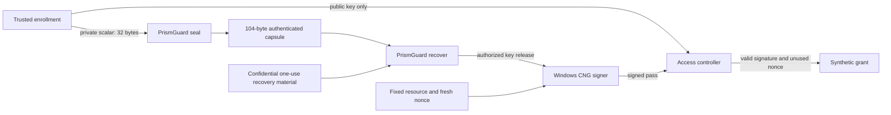

# PrismGuard Recovery Desk

**Recover a protected signing key, issue a pass, and verify a real application action.**

This offline Rust application supplies practical-environment evidence for the
Cryptographer entry. A fresh Windows CNG P-256 signing key is enrolled. Its
32-byte private scalar is encrypted by the unchanged PrismGuard capsule core.
After authenticated recovery, that scalar signs a nonce-bound synthetic
training-access request. A controller holding only the public key verifies
the signature and grants exactly one request.

This application performs an actual signature operation and verified state
change. It does not merely compare recovered bytes to an expected key.

## Run it

[Watch the 96-second narrated application demo](https://github.com/ShivaPriyanShanmuga/prismguard32#watch-the-recovery-desk-application).
The [transcript](../../media/recovery-desk/transcript.md) and
[English captions](../../media/recovery-desk/captions.srt) accompany the video.

From the repository root, using the installed Windows Rust toolchain:

```powershell
New-Item -ItemType Directory -Path build -Force | Out-Null
rustc --edition=2021 -D warnings -C opt-level=3 -C overflow-checks=yes apps/recovery-desk/main.rs -o build/recovery-desk.exe
.\build\recovery-desk.exe demo
.\build\recovery-desk.exe desk
python tools/recovery_desk_verify.py
```

No Cargo package download is needed. The application uses the installed
`bcrypt.dll` provider and OS randomness. It accepts no file paths, user keys,
credentials, network addresses, or real access-control targets. Its default
operation uses memory and terminal input/output only.

The interactive desk offers altered-capsule submission, genuine recovery,
pass issuance, pass verification, altered-signature submission, and a fresh
independent enrollment. Every grant is a synthetic in-memory training event.
No device, door, OS permission, account or external service is affected.

## Data flow



The original provider private handle, exported private blob, and enrollment
shares are dropped before the application begins recovery. The recovery desk
holds receiver material and, only after successful recovery, an owned scalar.
The controller has no scalar or recovery material. All roles currently share
one process; this is logical separation, with no physical-isolation claim.

## Binding and state

The capsule context binds a version, the synthetic lab identity, and the
SHA-256 fingerprint of the public verification key. The request encoding is
an explicit versioned domain, a fixed-width 16-byte fresh nonce, a 32-bit
resource code, and an action byte. The issuer checks the expected request
before consuming the recovered scalar. One signing attempt consumes it.

The controller verifies the request policy and signature before consuming
the challenge. An invalid pass therefore cannot consume the pending grant.
After success, the challenge is consumed. Replay protection is keyed to the
challenge rather than signature bytes: even the alternate mathematically
valid ECDSA encoding `(r,n-s)` cannot create a second grant.

## What uses which algorithm

| Operation | Implementation | Role |
| --- | --- | --- |
| Encrypt/decrypt the 32-byte scalar | PrismGuard's custom capsule | Submitted encryption construction |
| Bind public identity and hash public request | Windows CNG SHA-256 | Application hash; no plaintext encryption |
| Sign after successful recovery | Windows CNG ECDSA P-256 | Established consumer of the recovered key |
| Verify the public pass | CNG, independently checked in Python | Application authorization evidence |

ECDSA is credited prior work. It does not replace the submitted encryption
algorithm or claim a new signature primitive. The independent Python curve
code verifies public evidence only; it does not generate or sign with keys.

## Evidence

- 26 combined Rust test groups pass: 14 existing core groups and 12 new application groups.
- 32 fresh public passes are independently verified with Python big integers and SHA-256.
- All 32 alternate valid signature encodings are also verified; replay cannot create a second grant.
- Altered messages/signatures, wrong resource/nonce/action, wrong public key/context, eight failed recoveries, entropy shortage, and premature/second issuance are checked.
- A scripted session exercises the actual interactive `desk` command.
- `evidence/recovery-desk/` retains tests, captured output, public vectors,
  interactive output, source hashes, and the aggregate report. No private
  scalars, pad material or receiver shares are exported.

## Limits

The capsule's arithmetic probing model ends at authorized plaintext release.
CNG key import, signing, private-provider state and operating-system behavior
are outside that proof. No new end-to-end numerical forgery bound is claimed
for the composition with ECDSA. Standard signature/hash assumptions and correct
provider behavior are additional application assumptions.

Trusted enrollment and confidential one-use provisioning remain necessary.
The demo has no durable anti-rollback ledger or enrollment persistence. A
restart creates a new identity/session, not recovery of a persistent vault.
It is not a deployed physical access controller or production key service.
Volatile wipes and native-handle cleanup do not certify removal of every
register, spill, provider copy or crash dump. CNG failure closes the workflow.

## Primary references

- [CNG key blob format](https://learn.microsoft.com/en-us/windows/win32/api/bcrypt/ns-bcrypt-bcrypt_ecckey_blob)
- [CNG signatures](https://learn.microsoft.com/en-us/windows/win32/api/bcrypt/nf-bcrypt-bcryptsignhash)
- [CNG signature verification](https://learn.microsoft.com/en-us/windows/win32/api/bcrypt/nf-bcrypt-bcryptverifysignature)
- [NIST FIPS 186-5](https://doi.org/10.6028/NIST.FIPS.186-5)
- [NIST SP 800-186](https://doi.org/10.6028/NIST.SP.800-186)
